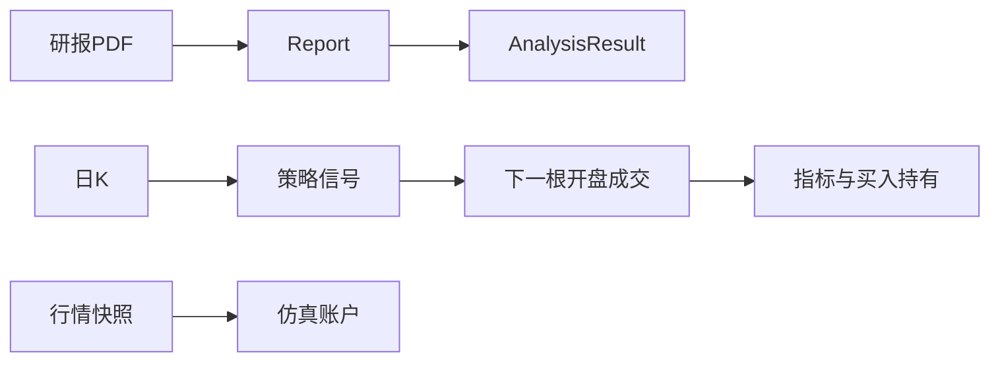

# 目录

- 摘要
- 1 引言
- 2 人机协作
  - 2.1 智能体
  - 2.2 技能
  - 2.3 MCP
  - 2.4 开源库
  - 2.5 对话、上下文、项目与记忆
- 3 问题表述
  - 3.1 设计与开发记录
- 4 方法
  - 4.1 研报记录与分析模型
  - 4.2 行情、缓存与颜色
  - 4.3 仿真交易
  - 4.4 投资概念与记账标准
  - 4.5 回测成交约定
  - 4.6 趋势与突破策略
  - 4.7 均值回归策略
  - 4.8 综合评分、配对与摆动指标
  - 4.9 回测指标
- 5 验证
  - 5.1 费用与账户读数
  - 5.2 信号与成交规则
  - 5.3 测试函数数目
  - 5.4 颜色与缓存读数
  - 5.5 摘要与引言命题对照
- 6 结论

# 摘要

本段交代任务。我在 Maddox Quant 里把投研材料收成一条可复核的链路：研报入库与结构化分析、A 股行情、一个全站仿真账户，以及只做多的日 K 回测。

本段交代约束。回测信号只能使用截至当日的 K 线，在下一根 K 线开盘成交；最后一根 K 线出现信号时不成交。买入数量按 100 股取整。

本段交代费用。代码中的默认佣金是成交额乘以 0.0003，单笔不低于 5 元。印花税只在卖出时按成交额乘以 0.0005 收取。

本段交代账户现金。仿真账户的起始现金是 1,000,000 元。回测页面的初始资金初值是字符串 `1000000`。接口要求调用方传入大于 0 的现金，服务端没有另写一个默认现金。

本段交代策略目录。`0522e31` 的策略目录写出 13 个内置策略。2026-09-09 的量化工作台设计记录当时只写下双均线与唐奇安突破两套规则。

本段交代本报告如何取证。行情快照缓存默认 90 秒，日 K 缓存默认 600 秒。我清点到 25 个测试文件、128 个测试函数，并引用其中已经写好的金额与信号断言。函数数目是仓库里的定义条数。我没有为这篇报告重新跑测试，因此这里不出现通过率，也不把条数写成学习成效。

# 1 引言

本段定义任务。我要解决的任务，是把研报 PDF、A 股报价和日 K，变成可以回看的分析记录、仿真账本和回测结果。

本段说明使用场合。这条链路用在四件事上：按关键词找回研报，查看个股或行业的分析字段，在仿真账户里按 6 位代码下单，以及用内置策略对照同一段日 K 上的买入持有。

本段说明技术约束。若信号能看见未来 K 线，或成交不扣佣金、印花税和整手，回测结果就不能当作投研记录来核对。

本段引用设计记录中的处理。2026-09-09 的设计记录要求仿真与回测分开记账，A 股只做多，策略只看截止当日的 K 线，开平仓在下一根开盘价成交。

本段说明当前实现相对该记录的范围。提交 `0522e31` 的目录在这两套规则之外，又写入趋势跟踪、均值回归、多因子、配对、MACD、海龟、布林、RSI、乖离、KDJ 和 ATR 通道。费用常数、整手和买入持有曲线写在同一套回测引擎里。

本段说明后文核对什么。后文用仓库里的模型字段、设计记录、颜色值和测试断言核对上述命题，并给出 25 个文件中的 128 个测试函数。核对对象是规则和读数，不是一次测试运行的成败，也不是我的学习分数。

# 2 人机协作

本段说明这一节的任务。引言之后，我说明撰写和实现时用到的五类工具：智能体、技能、MCP、开源库，以及 Cursor 里的对话、上下文、项目和记忆。这一节不新增交易数字。

## 2.1 智能体

本段说明智能体是什么。智能体按一个目标调用工具、阅读材料并交出产物。写这篇报告时，智能体的目标是只根据指定仓库组织文字。

本段说明本仓库里的模型调用边界。研报分析调用 DeepSeek 兼容接口，默认基址是 `https://api.deepseek.com/v1`，默认模型名是 `deepseek-chat`。2026-09-09 的设计记录写明，DeepSeek 不参与下单和回测。仿真成交与 CTA 信号都由仓库内的确定性函数完成。

## 2.2 技能

本段说明技能是什么。技能是一份事先写好的工序。它规定章节顺序、段首任务句、每段只讲一件事，以及方法各节要写出动机、做法和优点。

本段说明技能与仓库材料的分工。`research-paper-writing` 不在 maddox-quant 仓库内。它只约束这篇报告怎么写。报告中的金额、颜色和策略规则仍只来自该仓库的记录、模型和测试。

## 2.3 MCP

本段说明 MCP 是什么。MCP 是一套让智能体调用外部工具的协议。工具可以读仓库、查文档或操作应用，调用结果要能指回来源。

本段说明这篇报告实际依赖的证据通道。交易读数来自 git 对象 `0522e31` 中的源码与测试，不来自行情网站的当场拉取。仓库里的行情路径是另一件事：`MarketProvider` 在请求时调用 AKShare，并把结果放进进程内缓存。

## 2.4 开源库

本段列出后端依赖文件中的库。`backend/requirements.txt` 写下 FastAPI、Uvicorn、SQLAlchemy、psycopg2、Pydantic Settings、Alembic、python-multipart、pdfplumber、httpx、pytest、pytest-asyncio、reportlab、APScheduler、feedparser 和 akshare。版本约束写在该文件里，例如 FastAPI `>=0.115.0`，akshare `>=1.16.0`。

本段列出前端依赖文件中的库。`frontend/package.json` 写下 Next.js `16.3.3`、React `19.2.8`、TanStack Query、Recharts，以及开发依赖 Tailwind CSS 4、TypeScript 5 和 ESLint 9。

本段说明这些库在链路中的位置。FastAPI 提供接口，SQLAlchemy 映射后文的表，pdfplumber 抽取研报正文，feedparser 读取 RSS，APScheduler 用于采集调度，akshare 提供行情，Next.js 与 Recharts 绘制页面和曲线。设计记录写明不把 vn.py 嵌成子进程。

## 2.5 对话、上下文、项目与记忆

本段说明对话。对话是当前这条消息序列。它保存写作要求，例如第一人称、章节顺序，以及没有证据的数字不要写。

本段说明上下文。上下文是一次回答里能够读到的材料。这篇报告的上下文是 `0522e31` 的文件内容。本地工作副本在抓取远程之前停在更早的提交，因此文中读数以远程 `main` 为准。

本段说明项目。项目是 Cursor 打开的工作目录，这里是 maddox-quant 仓库。报告文件放在该目录的 `docs/project-report.md`。仓库里的业务项目则是投研站点本身，入口包括 `/market`、`/quant`、`/reports` 和 `/analysis`。

本段说明记忆。记忆是跨对话保留的编辑偏好。它可以提醒写作习惯，不能代替仓库里的断言。本文每个金额都能在第 5 节指回测试或常量。

# 3 问题表述

本段写出输入和输出。输入是研报 PDF、6 位股票代码、日 K（日期、开高低收、成交量、成交额）和仿真委托。输出是研报行、分析结果、行情页、仿真现金与持仓，以及一次回测的成交、权益曲线和指标。

本段写出必须遵守的标准。股票代码是 6 位数字。买入数量是 100 的整数倍，卖出允许把零股卖光。委托只有市价和限价。市价单的价格必须为空。限价必须大于 0。全站只有一个仿真账户。回测不修改该账户。

本段写出设计记录明确排除的范围。记录中的排除项包括实盘柜台、两融、期货、期权、港股、美股、用户上传策略脚本、Level-2、五档、分时和 Tick。涨跌停一字板与停牌的精细撮合也不在这期规则里。

本段写出成功标准。成功是账本和回测与上述规则一致，并且测试把关键金额和信号方向写成断言。仓库没有保存策略相对买入持有的市场成绩，因此成功标准里不包括这类盈利。

## 3.1 设计与开发记录

本段说明开发步骤文档记了什么。`docs/DEVELOPMENT.md` 把工作分成阶段 0 到阶段 6：骨架、研报、单篇分析、聚合看板、关注与通知、自动采集、打磨上线。文档给阶段 0 写的日程是 3 到 5 天，阶段 1 是 1 到 2 周，阶段 2 到 4 各 1 周，阶段 5 是 1 到 2 周，阶段 6 是 2 到 3 天。这些是文档里的计划文字。我没有另测实际耗时，所以不把它们写成花费天数。

本段说明 README 记下的阶段状态。README 的阶段表把 P0 到 P6 都标成完成。这张表停在打磨上线，没有把后来的行情页和十三套策略写进同一张表。

本段说明三份实现计划各自覆盖的范围。`2026-08-31` 的计划写 MVP。`2026-09-07` 的计划写 A 股行情页。`2026-09-09` 的计划写量化工作台。对应的两份规格分别是行情方案 A，以及仿真交易加 CTA 回测。

本段说明规格里锁定、后来仍有效的决定。量化规格写明只做仿真、全站一个账户、A 股只做多、代码为 6 位数字、回测不改仿真账、策略只用仓库内置模板、DeepSeek 不下单也不跑回测。行情规格写明请求时拉取、进程内缓存、快照不进 Postgres。

# 4 方法

本段给出全链路。研报进入 `Report`，分析进入 `AnalysisResult`。日 K 进入策略函数，信号延后到下一根开盘。行情快照同时供给仿真撮合。回测另画一条买入持有曲线。

本段说明后文各节的分工。4.1 写研报与分析模型。4.2 写行情和颜色。4.3 写仿真账户。4.4 写投资概念和记账标准。4.5 写回测何时成交。4.6 到 4.8 写十三套策略的动机、做法、使用场景和优点。4.9 写指标定义。

## 4.1 研报记录与分析模型

本段说明研报模型的动机。投研先要留下原文和去向，否则后面的行业、个股和观点无法指回同一篇文件。

本段说明研报模型的做法。`Report` 保存标题、来源、作者、发布日期、行业、板块、股票、摘要、全文、表格、文件路径、文件字节、文件哈希、标签和状态。文件哈希唯一。`AnalysisResult` 保存摘要、指标、因子、情感、投资逻辑、风险和原始响应。情感取值在分析提示中写成 `bullish`、`neutral` 或 `bearish`。`AnalysisJob` 保存同一次分析的状态与错误。`ReferenceItem` 用 `item_type`、`code` 和 `name` 保存行业与股票字典。`CollectSource` 默认类型和解析器都是 `rss`，默认 cron 是 `0 8 * * *`。

本段说明研报模型的优点。哈希把同一份 PDF 收成一行。分析字段和原文分行存放，看板可以按情感和因子聚合，同时仍能打开原来的文件。种子测试只断言插入量至少为 10、行业至少为 5、股票至少为 5，并且第二次种子插入量为 0。

## 4.2 行情、缓存与颜色

本段说明行情页的动机。设计记录写明，每次请求都直接打全市场源会把页面打空，因此采用请求触发、进程内 TTL、不把快照写入 Postgres 的方案。

本段说明行情页的做法。指数代码是 `000001`、`399001`、`399006`、`000300`，页面对应上证指数、深证成指、创业板指和沪深 300。涨跌家数用快照聚合。涨跌停判断用常数 `LIMIT_PCT = 9.8`，涨跌幅达到该值记为涨停一侧，小于等于其相反数记为跌停一侧。交易时段函数把上海时区的周一至周五、9:15 至 15:10 标成交易时间。快照缓存默认 90 秒，日 K 缓存默认 600 秒，AKShare 超时默认 75 秒。个股列表默认每页 50 条，接口允许 1 到 100。行业涨幅榜和跌幅榜在页面上各取 10 条。

本段说明颜色的做法。亮色背景 `#ffffff`，文字 `#171717`。暗色背景 `#0a0a0a`，文字 `#ededed`。正涨跌幅使用 `text-red-600`，其余涨跌幅使用 `text-emerald-600`，涨跌家数沿用同一对类名。分析图里，看多用 `#10b981`，中性用 `#a1a1aa`，看空用 `#ef4444`，缺省扇区用 `#71717a`。日 K 收盘线是 `#18181b`，成交量柱是 `#d4d4d8`，MA5、MA10、MA20 分别是 `#ef4444`、`#f59e0b`、`#2563eb`。回测图里策略权益沿用 `#18181b`，买入持有是 `#b45309`，回撤标记是 `#dc2626`，回撤填充是 `#fecaca`，网格是 `#f4f4f5`。

本段说明这套颜色的优点。报价遵循红涨绿跌，和 A 股阅读习惯一致。策略曲线和持有曲线用两种深色分开。情感图用另一组绿、灰、红，专门表示研报观点，不表示报价涨跌。

## 4.3 仿真交易

本段说明仿真账户的动机。投研需要一笔不会进入柜台的账，用来检查下单、冻结、成交和撤单是否按规则变化。

本段说明账户字段。`PaperAccount` 的主键固定按账户 1 使用。字段是可用现金 `cash`、冻结 `frozen`、重置基准 `starting_cash` 和更新时间。起始现金常量是 1,000,000。总权益等于现金加冻结再加持仓市值。有最新价时用最新价盯市，没有则用成本金额除以数量。

本段说明委托字段与状态。`PaperOrder` 记录代码、名称、方向、市价或限价、价格、数量、已成数量、状态和拒绝原因。状态是 `pending`、`filled`、`cancelled`、`rejected`。一期不拆部分成交。`PaperTrade` 记录成交价、数量、佣金和印花税。`PaperPosition` 记录数量和成本金额。

本段说明撮合做法。市价单在存在有效最新价时按最新价全部成交。限价买单在最新价小于或等于委托价时成交，限价卖单在最新价大于或等于委托价时成交，成交价用触发时的最新价。买入先冻结数量乘以参考价。参考价在市价下是最新价，在限价下是委托价。资金检查还加上这笔参考价对应的佣金。成交后按实际成交额、佣金和印花税结算，并退回多冻的现金。卖出按成交比例减少成本金额，数量为 0 时删除持仓。无最新价的市价单记为拒绝，且不冻结资金。只有 `pending` 可以撤单，买入撤单把冻结退回现金。

本段说明费用做法。佣金等于成交额乘以费率后四舍五入到 10 位小数，再与最低佣金取较大者。默认费率 0.0003，默认最低佣金 5 元。印花税在买入时为 0，在卖出时为成交额乘以 0.0005。

本段说明仿真规则的优点。冻结额和成交额分开，限价没有成交时现金仍可核对。费用和整手写在同一处，回测可以复用同一对函数。重置把委托、成交和持仓删掉，现金回到 `starting_cash`，冻结回到 0。

本段给出使用场景。研究一只 6 位代码时，我可以先下 100 股市价买单，再下限价买单观察冻结，最后撤单或等最新价触及后成交。这套动作不改变回测记录。

## 4.4 投资概念与记账标准

本段说明这一节的任务。交易规则依赖一组固定概念。下面只解释仓库里真正用到的概念，并把每个概念收到后文的做法或第 5 节的读数上。

本段说明只做多。卖出数量不能超过该代码已有持仓。系统没有融券字段，配对策略也不能卖出那只配对股票。设计记录把期货、期权和两融放在排除项里。

本段说明整手。A 股买入以 100 股为一手。买入数量必须是 100 的整数倍。卖出可以把不足 100 股的剩余仓位卖掉，测试里的 50 股卖出就是这条规则的例子。回测买入力度也按 100 股向下取整。

本段说明市价和限价。市价单不填写价格，有有效最新价时按最新价全部成交。限价单必须填写大于 0 的价格。买单在最新价小于或等于委托价时成交，卖单在最新价大于或等于委托价时成交。成交价用触发时的最新价，不用委托价本身代替成交价。

本段说明现金、冻结和权益。可用现金是还能继续支配的金额。冻结是限价买单尚未成交时先拨出的金额，等于数量乘以委托价。总权益等于可用现金加冻结再加持仓市值。重置把现金放回起始现金，并把冻结放回 0。

本段说明持仓成本。成本金额按成交额累加，不把佣金加进成本金额。卖出时按卖出数量占原数量的比例减少成本金额。数量为 0 则删除这行持仓。价格 100 元买入 100 股时，成本金额是 10,000 元，佣金 5 元只减少现金。

本段说明佣金和印花税在投资里的位置。佣金在买入和卖出都收，是成交额乘以费率后与最低佣金取较大者。印花税只在卖出收取。因此同一笔来回交易会付两次佣金和一次印花税。费率可以在回测请求里改写，默认仍是 0.0003、5 元和 0.0005。

本段说明简单均线。简单均线是窗口内收盘价之和除以窗口长度。双均线、趋势、布林中轨、乖离、多因子和 ATR 通道的中轨都用这个定义。

本段说明指数均线。MACD 的 EMA 用前 n 个价格的简单平均做种子，之后每一步是当日价格乘以 2/(n+1)，加上前值乘以 1 减这个系数。DIF 是快 EMA 减慢 EMA。DEA 是 DIF 再做一条 EMA。

本段说明总体标准差和 z 分数。标准差是各点离差平方的平均再开方，平均的分母是窗口里的个数。z 分数是最新观测减窗口均值，再除以这个标准差。均值回归用在收盘上，配对用在两只股票的价格比上。标准差为 0 时，这两处函数返回卖出。

本段说明下一根开盘和买入持有。信号在某根 K 线收盘后才能知道，成交放到下一根的开盘，这样成交价不是发出信号的那根收盘价。买入持有在第一根开盘用同样的整手和佣金买进，之后只按收盘盯市，中间不再买卖。

本段说明 CTA 在本仓库中的范围。设计记录把回测页签对标日频 CTA 回测，策略是仓库内的模板，默认按当时现金一次买满可买的整手，卖出则卖出全部持仓。它不接收用户上传的 Python。

## 4.5 回测成交约定

本段说明回测引擎的动机。策略函数如果直接在信号当日按收盘成交，就会把当日收盘信息用于当日成交。引擎把这两步拆开。

本段说明共同做法。13 个策略只返回 `buy`、`sell` 或空。引擎先处理上一根留下的意图：空仓才买，有仓才把全部持仓卖出。买入力度是当时现金能买到的最大 100 股整数倍，并且成交额加佣金不得超过现金。卖出收取佣金和印花税。处理完旧意图后，才用截至当前这根的 K 线计算新信号，并把意图留给下一根开盘。最后一根的信号不产生成交。K 线请求上限是 800 根。未传结束日时用上海时区的当天，未传开始日时从结束日回推 3 年；遇到无法回推的日期则把日改成 28。

本段说明买入持有的做法。持有基准在第一根开盘按同样的整手和佣金买入，之后只按每日收盘盯市，不再交易，因此没有卖出印花税。策略权益在第一根收盘时仍等于初始资金，直到后续开盘才可能成交。

本段说明该约定的优点。成交价能指到下一根的开盘，测试可以比较成交日是否晚于信号日。回测现金与仿真账户隔离，跑完回测不会改写那 1,000,000 元的纸面现金。

## 4.6 趋势与突破策略

本段说明这一组的共同动机。这一组在价格相对均线、通道或高低点发生方向变化时进出，用来记录趋势延续的假设。

### 双均线

本段说明双均线的动机。两条简单均线的交叉把“短周期转到长周期之上”收成一次全仓进出。

本段说明双均线的做法。快线周期必须为正且小于慢线。窗口不足慢线加 1 根时不发信号。上一根的快线小于或等于慢线，且当前快线高于慢线，则买入。上一根快线大于或等于慢线，且当前快线低于慢线，则卖出。默认快线 5、慢线 20。使用场景是 5 日均线从下向上穿过 20 日均线后，下一根开盘买入；再次下穿后下一根开盘卖出。

本段说明双均线的优点。规则只比较两个平均数的前后关系，参数非法时直接拒绝。它不需要标准差或平滑系数。

### 趋势跟踪

本段说明趋势跟踪的动机。有时只需要价格自己穿过一条均线，而不需要第二条均线。

本段说明趋势跟踪的做法。周期 n 必须为正。收盘从 n 日简单均线下方穿到上方则买入，从上方穿到下方则卖出。默认 n 为 20。使用场景是收盘连续处在 20 日均线下方之后，某日收盘站上均线，下一根开盘买入。

本段说明趋势跟踪的优点。它比双均线少一个参数，信号仍然要求“前一根在一侧、当前这根在另一侧”，单根刺破后立刻回到原侧不会单独构成交叉。

### 唐奇安突破

本段说明唐奇安突破的动机。趋势也可以用过去一段的最高价和最低价来定义，而不是用均线。

本段说明唐奇安突破的做法。通道长度 n 必须为正。比较用的最高价和最低价取自不包含当日的过去 n 根。收盘高于该最高价则买入，低于该最低价则卖出。默认 n 为 20。使用场景是 n 为 20 时，今日收盘创过去 20 日新高，下一根开盘买入；收盘跌破过去 20 日最低价，下一根开盘清仓。

本段说明唐奇安突破的优点。窗口排除当日，当日极值不会自己变成被突破的边界。高低价序列长度不一致时函数拒绝计算。

### 海龟突破

本段说明海龟突破的动机。入场和离场可以使用不同长度，离场往往短于入场。

本段说明海龟突破的做法。`entry_n` 与 `exit_n` 都必须为正。收盘高于不包含当日的过去 `entry_n` 日最高价则买入。收盘低于不包含当日的过去 `exit_n` 日最低价则卖出。两个条件同时成立时，函数先判断买入。默认 20 与 10。使用场景是收盘创过去 20 日新高后下一根开盘买入，之后收盘跌破过去 10 日最低价则下一根开盘卖出。

本段说明海龟突破的优点。短离场窗口可以在长入场趋势还没跌破时先退出。入场和离场的窗口在接口里分开，不必合成同一个 n。

### MACD 金叉

本段说明 MACD 的动机。均线交叉可以用指数平滑，把更近的价格权重大一些。

本段说明 MACD 的做法。DIF 是快 EMA 减慢 EMA。DEA 是 DIF 的信号线 EMA。EMA 的种子是前 n 个价格的简单平均，平滑系数是 2 除以 n+1。DIF 上穿 DEA 买入，下穿卖出。快线必须为正且小于慢线，信号线必须为正。样本短于慢线加信号线时不发信号。默认 12、26、9。使用场景是 DIF 从下方穿过 DEA 后，下一根开盘买入，死叉后卖出。

本段说明 MACD 的优点。指数平滑保留近期价格的更大权重，同时仍用交叉而不是绝对阈值决定进出。预热不足时返回空信号，不拿未形成的 DEA 去交易。

### ATR 通道

本段说明 ATR 通道的动机。突破宽度可以随近期波动变化，而不是固定一个价格距离。

本段说明 ATR 通道的做法。真实波幅取高减低、高与前收之差的绝对值、低与前收之差的绝对值三者的最大者。这里的 ATR 是真实波幅的 n 日简单平均，不是 Wilder 递推平均。中轨是 n 日收盘简单均线。收盘高于中轨加 m 倍 ATR 则买入，低于中轨减 m 倍 ATR 则卖出。n 至少为 2，m 必须为正。默认 n 为 14，m 为 2。使用场景是收盘升破均线加 2 倍该 ATR 后下一根开盘买入，跌破均线减 2 倍该 ATR 后卖出。

本段说明 ATR 通道的优点。通道半宽跟着近期高低和跳空变化。它和布林带不同：布林带在下轨买入，ATR 通道在上轨买入。

## 4.7 均值回归策略

本段说明这一组的共同动机。这一组在价格相对近期中枢偏弱时买入，回到中枢附近时卖出，用来记录超跌后回归的假设。

### 均值回归

本段说明均值回归的动机。偏离可以用 z 分数写成“几个标准差”，便于和别的价格尺度比较。

本段说明均值回归的做法。z 分数是最新收盘减去 lookback 日简单均线，再除以这 lookback 个收盘的标准差。标准差是离差平方和除以个数 n 后开方，分母是 n。z 小于或等于负的 `entry_z` 则买入。z 大于或等于 0 则卖出。标准差为 0 时卖出。lookback 至少为 2，`entry_z` 必须为正。默认 20 与 1.5。使用场景是 20 日 z 分数落到 −1.5 或更低时买入，价格回到均线一侧、z 不小于 0 时卖出。

本段说明均值回归的优点。买卖阈值不对称：买入要求足够负的 z，卖出只要求回到均线。这样平仓不必等待相反方向的极端值。

### 布林带回归

本段说明布林带的动机。同一套均线和标准差可以画成价格通道，进出直接比较收盘和轨道。

本段说明布林带的做法。中轨是 n 日简单均线。下轨是中轨减 k 倍标准差，标准差同样除以 n。收盘小于或等于下轨则买入。收盘大于或等于中轨则卖出。标准差为 0 时卖出。n 至少为 2，k 必须为正。默认 20 与 2。使用场景是收盘触及或跌破下轨后买入，重新站上 20 日均线后卖出。上轨不单独作为卖出条件。

本段说明布林带的优点。带宽随波动放大或缩小。卖出锚在中轨，和页面文案里的“回到中轨卖出”一致。

### 均线乖离

本段说明乖离的动机。偏离也可以写成相对均线的百分比，阅读时不必先换算 z 分数。

本段说明乖离的做法。乖离率等于收盘除以 n 日均线再减 1，然后乘以 100。乖离小于或等于负的 entry 则买入。乖离大于或等于 0 则卖出。均线为 0 时不发信号。n 必须为正，entry 必须为正。默认 n 为 20，entry 为 5。使用场景是相对 20 日均线向下偏离达到 5% 或更多时买入，乖离回到 0 或以上时卖出。

本段说明乖离的优点。阈值的单位是百分比，和报价涨跌幅同一类语言。它不依赖标准差，横盘时只要均线不为 0 仍能计算。

### RSI 超买超卖

本段说明 RSI 的动机。回归也可以只看上涨和下跌的平均幅度，而不看价格相对均线的位置。

本段说明 RSI 的做法。函数按 Wilder 方式计算。第一段平均涨幅和平均跌幅是前 n 个变动的简单平均，之后用前值乘以 n−1 加新值再除以 n。平均跌幅为 0 时 RSI 取 100。RSI 小于或等于超卖线则买入，大于或等于超买线则卖出。约束是 n 大于 1，并且 0 小于超卖、超卖小于超买、超买小于 100。默认 14、30、70。使用场景是 14 日 RSI 落到 30 或以下时买入，升到 70 或以上时卖出。

本段说明 RSI 的优点。超买和超卖是两道独立门槛，和 z 分数那类“回到 0 就卖”不同。非法门槛在计算前被拒绝。

## 4.8 综合评分、配对与摆动指标

本段说明这一组的共同动机。这一组把多个条件合成一次进出，或比较两只股票的相对价格。

### 多因子时序评分

本段说明多因子评分的动机。单只股票上可以同时看趋势、中期动量和短期回调，而不是只看一个交叉。

本段说明多因子评分的做法。名称在目录里写作“多因子选股”。实现是单票时间序列评分，不对一篮子股票排序。三项各记 1 分：收盘高于 lookback 日均线，lookback 日动量为正，近 5 日收益为负。近 5 日这档写死在函数里，不是参数。前一分低于 2 且当前分达到 2 则买入，前一分不低于 2 且当前分低于 2 则卖出。lookback 至少为 6，默认 20。使用场景是价格回到均线之上且 20 日涨幅转为正、分数跨过 2 分之后，下一根开盘买入。

本段说明多因子评分的优点。进出要求分数跨过 2 分，而不是每一项变动都交易。三项里至少两项同时成立，才满足买入一侧的门槛。

### 统计套利与配对交易

本段说明配对的动机。相对价值看两只股票价格之比，而不是主连自己的绝对涨跌。

本段说明配对的做法。对比值序列计算 z 分数，标准差仍除以个数。z 小于或等于负的 `entry_z` 时买入主连。z 大于或等于 0，或标准差为 0 时，卖出主连。窗口里配对价格小于或等于 0 则不发信号。两列长度必须相等。系统不能做空配对股。默认 lookback 为 20，`entry_z` 为 2。配对代码必须是另一只 6 位代码。使用场景是主连相对配对股的 z 落到 −2 或更低时买入主连，比值回到均值后卖出。

本段说明配对的优点。它把“谁更便宜”写成价格比的 z 分数，并且在只做多的约束下只交易主连。缺少配对代码或代码与主连相同会被接口拒绝。

### KDJ 低位金叉

本段说明 KDJ 的动机。摆动指标可以把高低区间里的位置和交叉合在一起，避免一有交叉就交易。

本段说明 KDJ 的做法。RSV 用 n 日最高价和最低价。最高价等于最低价时 RSV 取 50。K 与 D 从 50 起步，K 等于三分之二的旧 K 加三分之一的 RSV，D 等于三分之二的旧 D 加三分之一的新 K。买入要求前一根 K 上穿 D，并且前一根的 K 和 D 都不高于低位门槛。卖出发生在 K 下穿 D，或当前 K 达到高位门槛。n 至少为 2，且 0 小于低位、低位小于高位、高位小于 100。默认 9、20、80。使用场景是 K 和 D 都在 20 或以下时出现金叉，下一根开盘买入；K 下穿 D，或 K 达到 80 或以上时卖出。

本段说明 KDJ 的优点。低位条件把金叉限制在区间下沿。高位卖出不必等待死叉，价格冲到门槛即可退出。

## 4.9 回测指标

本段说明指标的动机。一次回测需要一组固定定义，用来比较策略期末权益和买入持有，而不是只看成交笔数。

本段说明指标做法。总收益是策略期末权益除以本次初始资金再减 1，已含佣金和印花税。持有收益用持有曲线的期末值做同样计算。策略绝对盈利是策略期末权益减持有期末权益，再除以初始资金。结果为正时胜出方记为策略，为负记为持有，相等记为持平。年化是 1 加总收益的 365 除以首末日期间隔天数次方，再减 1。间隔不足 1 天按 1 天。最大回撤是收盘盯市权益相对历史峰值的最大跌幅，公式是峰值减当前值再除以峰值。胜率是完整买卖轮次里扣费后盈利轮次的比例，没有完整轮次时为 0。盈亏比是盈利轮次净利合计除以亏损轮次净亏合计，没有亏损轮次时为 0。成交次数是买卖笔数之和，包含尚未平仓的单边成交。

本段说明指标的优点。持有曲线和策略曲线使用同一初始资金、同一整手和同一佣金函数，胜出方由两条期末权益比较得出。年化用日历天数，定义里没有 252 个交易日。没有亏损轮次时盈亏比写 0，避免把空的分母写成无穷大。

# 5 验证

本段说明验证的任务。这一节把摘要和引言中的命题对到仓库里的读数或测试函数数目。我核对的是断言和常量。我没有为这篇报告执行测试套件，因此不写通过、失败或学习成效。

## 5.1 费用与账户读数

本段核对默认费用。`test_trading_fees.py` 断言成交额 1,000 的佣金为 5，成交额 100,000 的佣金为 30。卖出 10,000 的印花税为 5，买入 10,000 的印花税为 0。这四笔与默认费率 0.0003、最低佣金 5、卖出印花税 0.0005 一致：1,000 乘以 0.0003 等于 0.3，低于 5，故取 5；100,000 乘以 0.0003 等于 30；10,000 乘以 0.0005 等于 5。

本段核对费率可以改。同一文件断言费率 0.001 且最低佣金为 0 时，100,000 的佣金为 100。费率 0.0003 且最低佣金为 8 时，1,000 的佣金为 8。费率与最低佣金都为 0 时，100,000 的佣金为 0。卖出印花税费率 0.001 时，10,000 的税为 10；同一费率的买入税为 0；税率为 0 的卖出税为 0。

本段核对仿真市价买入。`test_paper_broker.py` 用最新价 100 买入代码 `600519` 共 100 股，断言成交后现金为 989,995，持仓数量为 100，成本金额为 10,000。成交额 10,000 的默认佣金为 5，1,000,000 减 10,000 再减 5 等于 989,995。

本段核对限价冻结与成交。同一文件用委托价 90、数量 100、当时最新价 100 下买单，断言状态为 `pending`，现金 991,000，冻结 9,000。随后最新价改为 89 再撮合，断言状态为 `filled`，现金 991,095，冻结 0。9,000 的冻结退回后，成交额 8,900 加最低佣金 5，从 1,000,000 得到 991,095。

本段核对撤单、拒绝和重置。撤掉上述未成交限价单后，现金回到 1,000,000，冻结为 0。没有最新价的市价单状态为拒绝，现金仍为 1,000,000，冻结为 0。重置后现金为 1,000,000，冻结为 0，持仓、委托和成交列表都为空。

本段核对卖出费用与权益。最新价 10 的代码先买 200 股再卖 50 股。断言剩余数量 150，成本金额 1,500，现金 998,489.75。买入成交额 2,000 加佣金 5，卖出成交额 500 的佣金为 5、印花税为 0.25，两步之后现金为 998,489.75。成本按卖出比例减少：2,000 乘以 150/200 等于 1,500。另一次买入 100 股、最新价 10 的账户权益断言为 999,995，等于现金 998,995 加市值 1,000。

本段核对整手。买入数量 50 时，测试断言错误码为 `invalid_lot`。卖出则允许 50 股，上一段的卖出断言已经使用这个数量。

本段核对回测起点现金。`test_cta_backtester.py` 断言传入 12,345.67 时，权益曲线第一点的策略权益等于 12,345.67。传入 50,000 时，第一点等于 50,000。传入 1,000,000 且首日尚未按信号成交时，第一点策略权益等于 1,000,000。

## 5.2 信号与成交规则

本段核对下一根开盘成交。双均线回测使用快线 5、慢线 20 和一串合成日 K。测试断言存在买单，成交日晚于第一根金叉的日期，且成交价等于成交日那根 K 线的开盘价。

本段核对最后一根不成交。把同一串 K 线截到尚未形成可成交后续 bar 的长度后，测试断言成交列表为空，且 `trade_count` 为 0。

本段核对持有曲线。权益点同时含 `value` 和 `hold`。持有值等于首根开盘最大整手买入后的剩余现金加持仓乘收盘。期末持有值使用最后一根收盘。持有收益断言等于持有期末值除以初始资金再减 1。策略绝对盈利断言等于两条期末权益之差除以初始资金。胜出方按该差为正、为负或为零，分别断言为 `strategy`、`hold` 或 `tie`。

本段核对策略信号方向。下表只记录测试断言的方向，不记录一段真实行情的收益。

| 测试所在文件中的行为 | 断言 |
| --- | --- |
| 双均线快线 20、慢线 5 | 拒绝 |
| 唐奇安，n 为 3，收盘 14 高于此前高点 | 买入 |
| 趋势，n 为 5，末值 12 穿过均线向上 | 买入 |
| 趋势，n 为 5，末值 10 穿过均线向下 | 卖出 |
| 均值回归，20 日窗口，末值 6，entry_z 为 1.5 | 买入 |
| 均值回归，20 个 10 | 卖出 |
| 多因子，lookback 为 10，前段为 10、末值为 12 | 买入 |
| 配对，主连末值 8、配对为 10，entry_z 为 1.5 | 买入 |
| 配对，两边都是 10 | 卖出 |
| MACD，12、26、9，长度 20 的常数序列 | 空信号 |
| MACD，先降后升的 100 根序列 | 序列中出现买入 |
| 海龟，entry_n 为 3、exit_n 为 2 | 一组数据买入，另一组卖出 |
| 布林，n 为 20、k 为 2，末值 6 | 买入 |
| 布林，20 个 10 | 卖出 |
| RSI，14、30、70，连续下跌序列 | 买入 |
| RSI，连续上涨序列 | 卖出 |
| 乖离，n 为 20、entry 为 5，末值 8 | 买入 |
| 乖离，20 个 10 | 卖出 |
| KDJ，n 为 9、低位 20、高位 80 | 序列中出现买入 |
| ATR 通道，n 为 14、m 为 2 | 上破买入，下破卖出 |

本段核对策略个数。`STRATEGIES` 列出 13 个标识：`dual_ma`、`breakout`、`trend`、`mean_reversion`、`multi_factor`、`pairs`、`macd`、`turtle`、`bollinger`、`rsi`、`bias`、`kdj`、`atr`。未知标识在接口上返回错误码 `invalid_strategy`。2026-09-09 设计记录的策略表只有前两行。当前目录多出的 11 行是后来的提交写入的，设计记录原文没有改写成 13 行。

本段核对回测不改仿真账户。`test_quant_api.py` 在回测请求使用现金 1,000,000 的场景下，断言仿真账户不存在，或现金仍为 1,000,000。

## 5.3 测试函数数目

本段说明计数口径。下表统计 `0522e31` 里以 `def test_` 或 `async def test_` 定义的函数。这是定义条数。它不表示这些函数在某次运行中通过，也不表示学习成效。

| 文件 | 测试函数 |
| --- | ---: |
| `test_aggregation.py` | 4 |
| `test_analysis_api.py` | 2 |
| `test_analyzer.py` | 2 |
| `test_collect_sources.py` | 4 |
| `test_cta_backtester.py` | 10 |
| `test_cta_strategies.py` | 17 |
| `test_database.py` | 1 |
| `test_errors.py` | 3 |
| `test_health.py` | 1 |
| `test_llm_client.py` | 1 |
| `test_market_api.py` | 5 |
| `test_market_provider.py` | 10 |
| `test_market_service.py` | 9 |
| `test_paper_api.py` | 4 |
| `test_paper_broker.py` | 13 |
| `test_pdf_parser.py` | 8 |
| `test_quant_api.py` | 5 |
| `test_report_file.py` | 3 |
| `test_report_model.py` | 1 |
| `test_reports_import.py` | 6 |
| `test_runtime.py` | 2 |
| `test_seed.py` | 1 |
| `test_trading_fees.py` | 4 |
| `test_ttl_cache.py` | 7 |
| `test_watchlist.py` | 5 |
| 合计 25 个文件 | 128 |

本段说明与交易命题直接相关的条数。费用断言在 4 个函数里。仿真经纪测试有 13 个函数。策略函数测试有 17 个。回测引擎测试有 10 个。量化接口测试有 5 个。仿真接口测试有 4 个。这些数字是上表的分组，总和仍受 128 这个定义条数约束。

## 5.4 颜色与缓存读数

本段核对主题色。`globals.css` 写明亮色背景 `#ffffff`、文字 `#171717`，暗色背景 `#0a0a0a`、文字 `#ededed`。

本段核对报价色与情感色。行情页和量化页把大于 0 的涨跌幅标成 `text-red-600`，其余标成 `text-emerald-600`。三处分析图把看多写成 `#10b981`，中性写成 `#a1a1aa`，看空写成 `#ef4444`。报价红涨与情感图绿多是两套编码，仓库没有把它们收成同一个色板常量。

本段核对图形色。日 K 的 MA5、MA10、MA20 为 `#ef4444`、`#f59e0b`、`#2563eb`。收盘线 `#18181b`，成交量 `#d4d4d8`，网格 `#f4f4f5`。回测策略线 `#18181b`，持有线 `#b45309`，回撤线与点 `#dc2626`，回撤填充 `#fecaca`。

本段核对缓存默认值。配置默认 `market_cache_ttl_seconds` 为 90，`market_kline_ttl_seconds` 为 600。示例环境文件写下同样的 90、600，以及 `MARKET_AKSHARE_TIMEOUT_SECONDS=75`。设计记录建议快照 TTL 落在 60 到 120 秒、日 K 落在 5 到 15 分钟。90 秒和 600 秒落在这两段文字范围内。记录里的“约数十秒”是当时对全市场请求的描述，不是我在这篇报告里重新测量的读数。

本段核对分页。回测成交和量化自选使用 `LIST_PAGE_SIZE = 10`。回测历史接口默认返回 20 条，上限 100。研报列表和通知列表使用每页 20 条。聚合里的行业与因子上限写为 10。

## 5.5 摘要与引言命题对照

本段把前文主要命题收成一张对照表。每一行都能回到前面的读数或函数条数。

| 命题 | 证据 |
| --- | --- |
| 研报、分析、行情、仿真和回测构成同一仓库中的链路 | `Report`、`AnalysisResult`、行情服务、`PaperAccount`、`BacktestRun`；相关测试见第 5.3 节各文件 |
| 信号用截至当日的 K 线，下一根开盘成交 | 成交日晚于金叉日，成交价等于当日开盘 |
| 最后一根信号不成交 | `trade_count` 断言为 0，成交列表为空 |
| 只做多，买入按 100 股取整 | 买入 50 股断言 `invalid_lot`；卖出 50 股可以成交 |
| 默认佣金 0.0003 且不低于 5 元 | 1,000 对应 5；100,000 对应 30 |
| 印花税仅卖出，费率 0.0005 | 买入 10,000 为 0；卖出 10,000 为 5 |
| 仿真起始现金 1,000,000 | 常量与重置、拒绝、撤单后的现金断言 |
| 市价买入 100 股、价格 100 后现金为 989,995 | `test_paper_broker.py` |
| 限价 90 冻结 9,000；最新价 89 成交后现金 991,095 | 同一文件 |
| 卖出 50 股后现金 998,489.75，成本 1,500 | 同一文件 |
| 权益在价格 10、持仓 100 时为 999,995 | 同一文件 |
| 回测首点策略权益等于传入现金 | 12,345.67 与 50,000 |
| 回测不改仿真现金 | 账户为空或现金仍为 1,000,000 |
| 当前目录有 13 个策略 | `STRATEGIES` 的 13 个 `id` |
| 设计记录当时写 2 个策略 | 2026-09-09 设计文档的策略表 |
| 持有收益、绝对盈利和胜出方有定义 | 权益点中的 `hold` 与三条 `winner` 断言 |
| 快照缓存 90 秒，日 K 缓存 600 秒 | 配置默认值与示例环境文件 |
| 测试函数 128 个，分布在 25 个文件 | 第 5.3 节逐文件计数 |
| 本文不把测试通过写成学习成效 | 上表是定义条数；本文没有新的运行结果 |

# 6 结论

本段重述问题与做法。我处理的问题，是让研报、仿真账本和日 K 回测按同一套可见规则留下记录。做法是把信号限制在已出现的 K 线上，在下一根开盘成交，并用默认佣金、卖出印花税和 100 股整数倍同时约束仿真与回测。

本段重述最硬的读数。1,000 元成交额的佣金是 5 元，100,000 元是 30 元，10,000 元卖出的印花税是 5 元。价格 100 元买入 100 股后现金是 989,995 元。限价 90 元未成交时冻结 9,000 元，最新价 89 元成交后现金是 991,095 元。这些数字写在测试断言里。

本段说明使用上的边界。系统只做多，配对交易不能做空配对股。标准差除以个数 n。ATR 通道里的波动是真实波幅的简单平均。盈亏比在没有亏损轮次时记为 0。年化用 365 除以日历天数。报价用红涨绿跌，研报情感图用绿表示看多。设计记录排除了实盘柜台和用户策略脚本。

本段说明记录之间的范围差。README 的阶段表写到 P0 至 P6。行情页和 13 个策略出现在其后的提交里。2026-09-09 的设计记录仍是两策略版本。引用该记录时，我把“当时的决定”和“`0522e31` 的目录”分开写。

本段说明下一步可以核对、但本文没有测量的内容。仓库没有一份已核对的实盘收益、夏普比率或全市场耗时。若要比较策略和买入持有在某只股票上的高低，需要另一次带日期和代码的回测，并保存那时的指标。本文的 128 只说明仓库里有多少个测试函数，不说明那些函数刚刚通过，也不说明我因此学会了交易。
